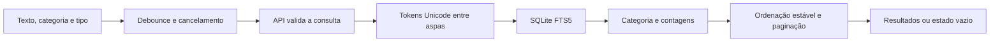

# Investigação: descoberta de servidores e canais

## Conclusão baseada no que foi obtido

O app Órbita foi criado como uma implementação independente do escopo solicitado. **Não foi possível verificar como o Discord implementa a descoberta**: as três tentativas de obter conteúdo público falharam no proxy. Nenhum JavaScript, HTML, mapa de código, tráfego autenticado ou pacote do Discord foi analisado. Não há Evidence IDs do REA para o Discord nesta entrega.

Isso permite entregar o novo app, mas deixa a parte de engenharia reversa do Discord **bloqueada**. Não se atribui ao Discord a arquitetura, o SQLite, os algoritmos, os dados ou o design deste projeto.

## Evidências de acesso

[Registro bruto das tentativas](evidence/discord-access.json), com URLs e instantes UTC registrados automaticamente.

| Destino solicitado                                        | Resultado observado                              | O que isso estabelece                                                 |
| --------------------------------------------------------- | ------------------------------------------------ | --------------------------------------------------------------------- |
| `https://discord.com`                                     | Proxy: `Tunnel connection failed: 403 Forbidden` | A página não foi obtida nesta tentativa.                              |
| `https://discord.com/servers`                             | Mesmo bloqueio                                   | A página de descoberta não foi obtida.                                |
| Guia público de Server Discovery em `support.discord.com` | Mesmo bloqueio                                   | O conteúdo do guia e sua disponibilidade atual não foram verificados. |

Uma URL pretendida não é prova de que a rota exista hoje ou de que tenha o comportamento esperado. Não foram coletados bytes que permitam calcular hashes de artefatos do Discord. A verificação local anterior também não encontrou um pacote do Discord nos caminhos padrão consultados; ela não descreve o computador do usuário.

Os domínios `discord.com` e `support.discord.com` foram adicionados ao rascunho de rede, mas isso não comprova aplicação da política na instância atual nem acesso bem-sucedido. Para retomar a análise do Discord, é necessário acesso permitido ou um artefato/captura fornecido pelo usuário.

## Decisões originais do Órbita

| Recurso implementado                              | Fonte da decisão                       | Evidência verificável nesta entrega                |
| ------------------------------------------------- | -------------------------------------- | -------------------------------------------------- |
| Catálogo e abas de comunidades/canais             | Escopo escolhido pelo usuário          | `src/App.tsx`, consultas e testes HTTP             |
| Busca por prefixos e normalização de acentos      | Escolha de produto e arquitetura local | `server/search.ts`, esquema FTS5 e testes de busca |
| Filtros com contagens e ordenação                 | Escolha de produto                     | `Store.discover`, testes e fluxos de navegador     |
| Entrada na comunidade antes de escrever           | Regra desta demonstração               | Validação no backend, testes HTTP e navegador      |
| Mensagens persistidas e paginação por cursor      | Escolha de arquitetura                 | SQLite, testes de reabertura e histórico           |
| Visual escuro, barra de comunidades e ilustrações | Design original                        | Componentes, CSS e capturas do próprio Órbita      |

### Como a busca desta implementação funciona

Exemplo: `programacao` encontra a tag fictícia `Programação`; `progra` também a encontra por prefixo. `dev projetos` exige ambos os tokens. Pontuação sem palavras retorna zero resultados. Não há busca semântica, correção ortográfica, operadores avançados ou pesquisa no conteúdo de mensagens neste escopo de descoberta.

Quando uma busca tem texto, a ordem recomendada usa `bm25` do SQLite: nome tem peso 8, tags 5, nome da comunidade 3 e descrição 2. Essa é uma decisão **deste projeto**. Categorias contam os resultados da consulta antes da seleção de categoria. Cada página contém até seis resultados. Os IDs de ordenação aceitos são mapeados para expressões SQL fixas.

## O que falta para a engenharia reversa do Discord

1. Obter os artefatos públicos permitidos e registrar URL final, instante, SHA-256 e versão identificável.
2. Analisar uma única vez com REA e selecionar módulos relacionados à descoberta, sem confundir coincidências de texto com execução observada.
3. Associar eventos de interface à construção das requisições e à exibição de resultados, preservando Evidence IDs e localizações de código.
4. Caso seja necessário comportamento autenticado, usar uma sessão autorizada ou captura sanitizada fornecida pelo usuário; não solicitar senha/token em chat.
5. Separar comportamento observado, inferência estática e backend desconhecido. O frontend não permite confirmar como o servidor privado indexa ou ranqueia resultados.

Não foi copiado código ou identidade visual do Discord. REA está disponível no ambiente para continuar a investigação assim que houver um alvo acessível.
